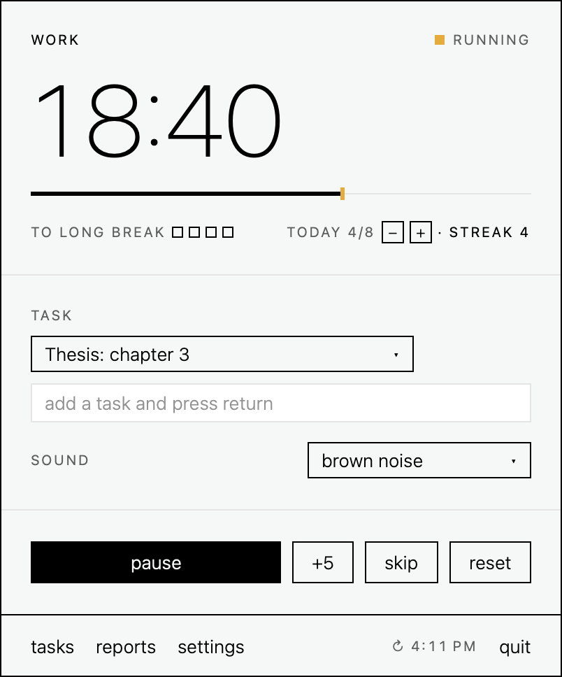
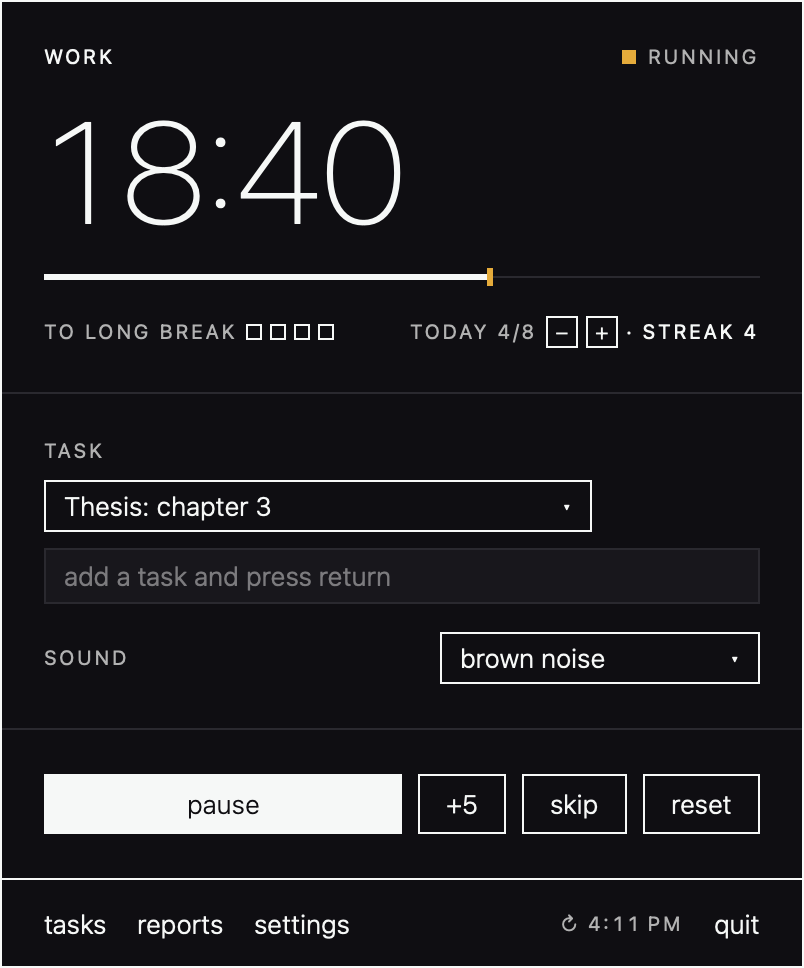
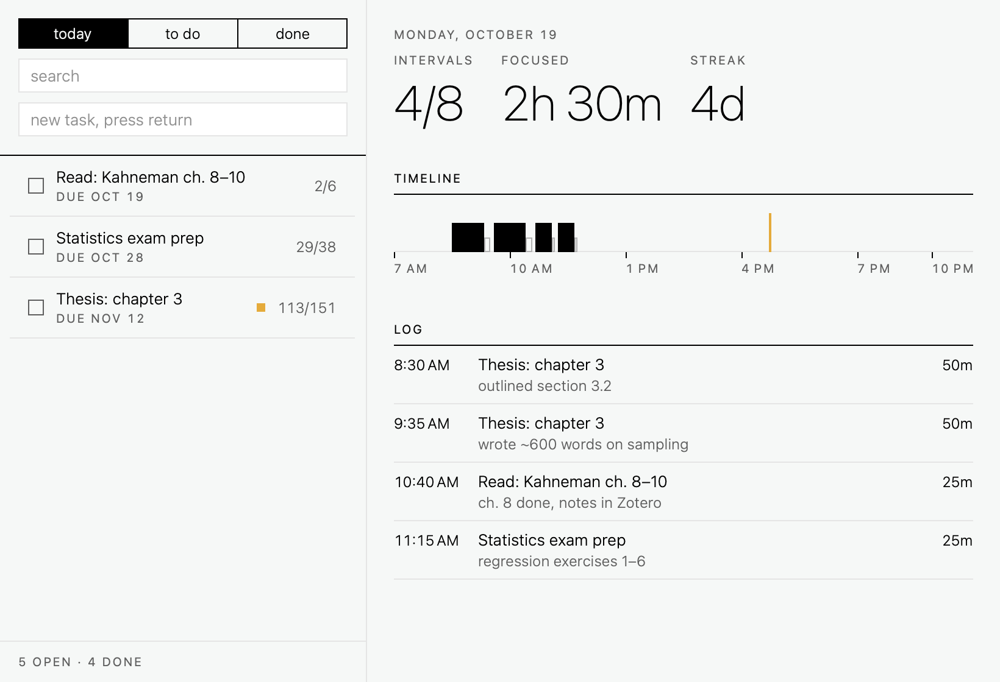
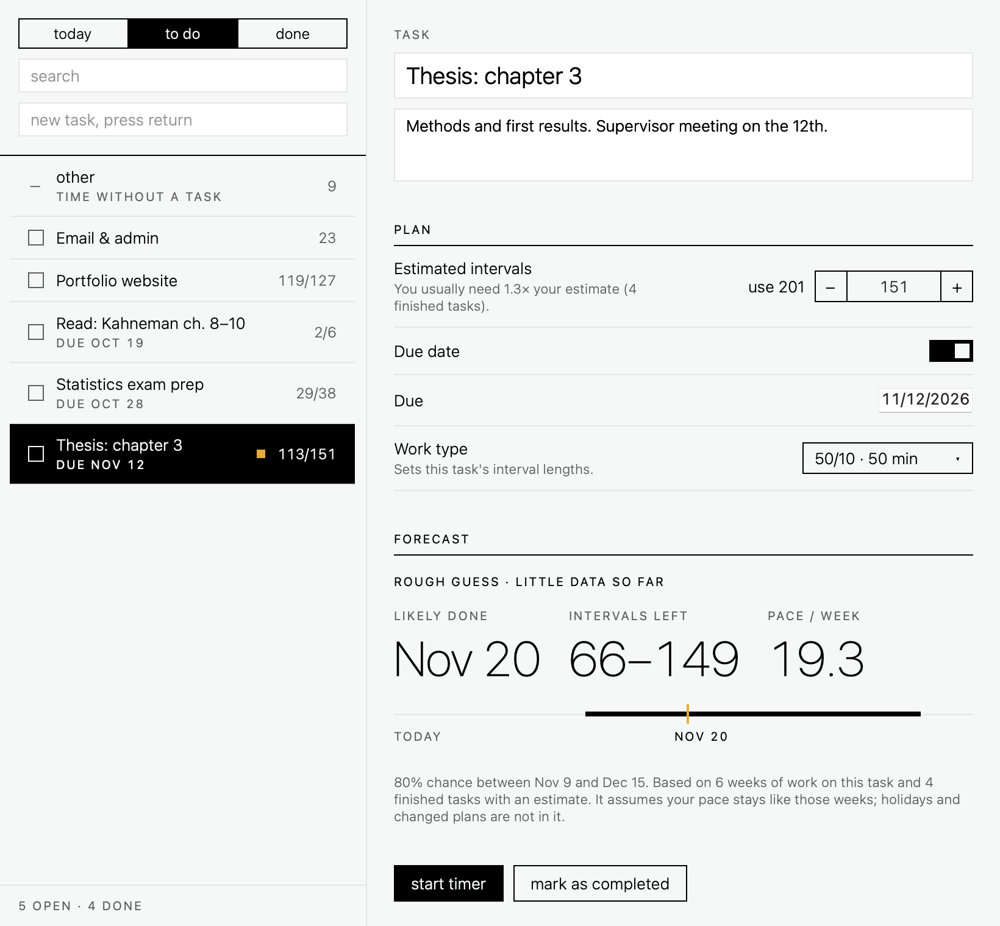
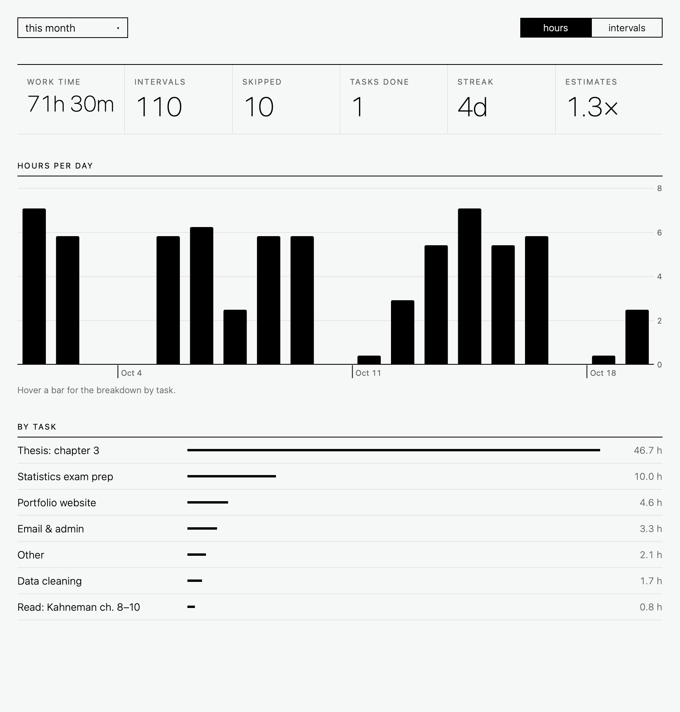
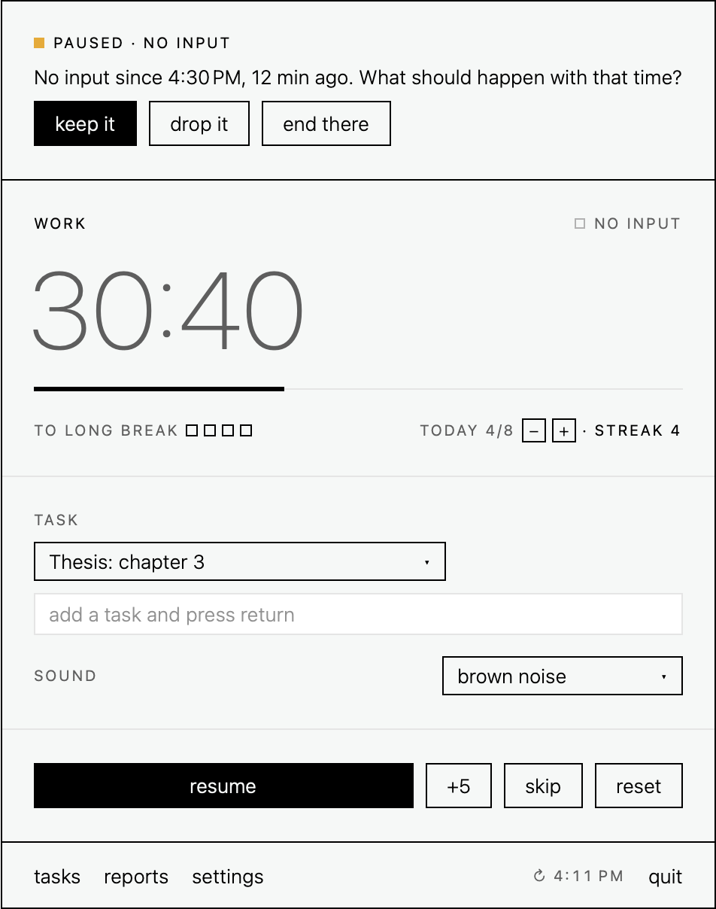
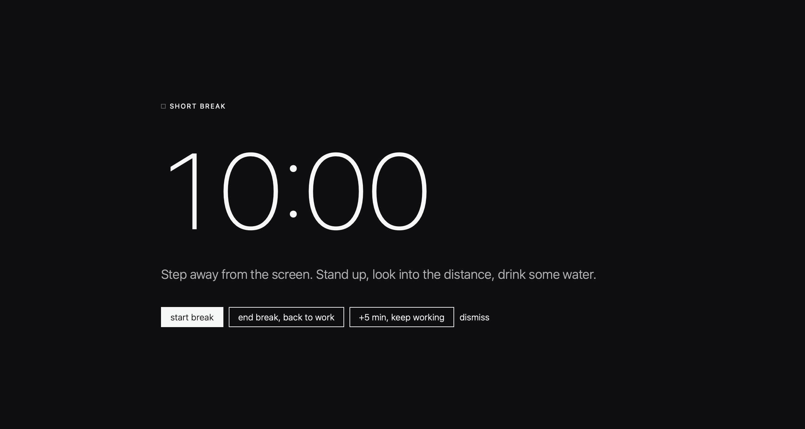
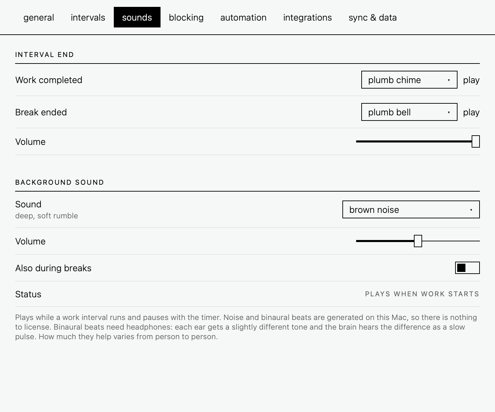
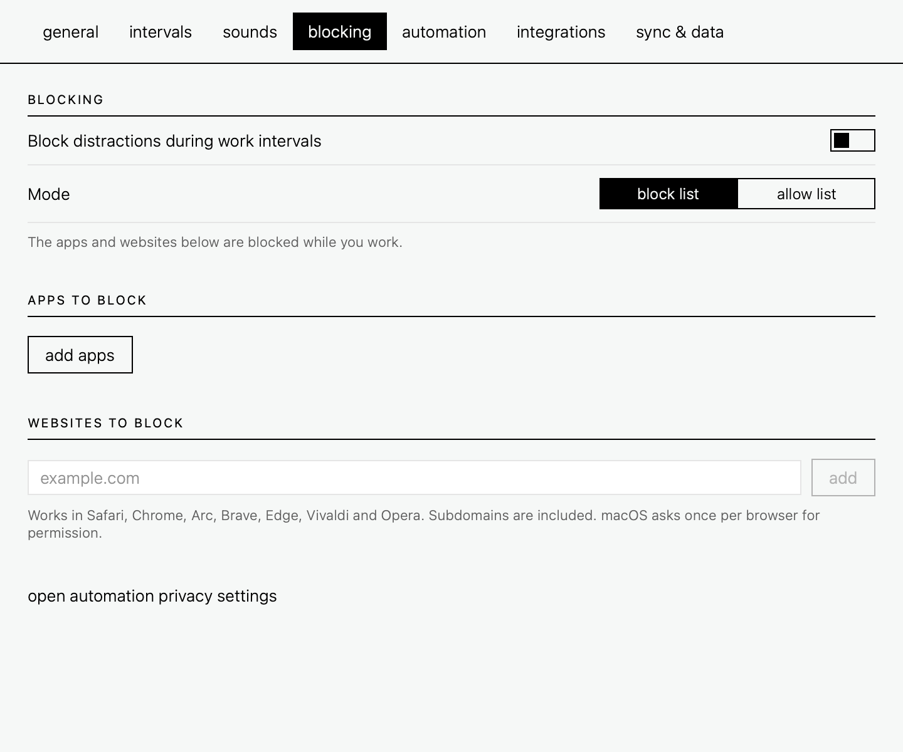

# plumb · Pomodoro timer for macOS

**plumb** is a free, open-source Pomodoro timer and focus timer for the Mac menu bar.
It keeps honest time (it notices when there is no input and asks instead of assuming),
learns how far your estimates are off, and forecasts when a task will be done. Local-first: no account, no subscription;
your data stays in a folder you control and syncs through any cloud folder you like.

Work intervals and breaks, tasks, daily goals and streaks, reports, website and app
blocking, white noise and binaural beats, Shortcuts automation, a command line tool and
an MCP server for AI assistants.

<p align="center">
  
  &nbsp;
  
</p>

## Screenshots

**Today**: progress against your daily goal, streak, a timeline of the day and a log with
a one-line note per interval.



**Forecast**: from your real pace and how far your past estimates were off, plumb
predicts when a task will likely be done, with an 80% range, what it is based on, and a
note when there is little data behind it.



**Reports**: work time, intervals, skipped, streak and estimate accuracy; hours per day
and per task.



**Honest time**: after a stretch without keyboard or mouse input, the timer pauses at the
moment input stopped and asks what to do with that time. No input is not the same as no
work, so keeping it is the default.



**Breaks that happen**: an optional full-screen card when a work interval ends.



**Background sound and blocking**: noise and binaural beats generated on the Mac;
distracting apps and websites blocked during work.

<p>
  
  
</p>

<sub>Screenshots use invented demo data; regenerate them with `scripts/screenshots.sh`.</sub>

## Design

A monochrome, device-like look: off-white and ink (near-black in dark mode), 1 pt hairline
rules instead of cards, square corners, no shadows or gradients, thin type with large thin
numerals, lowercase labels. A single amber lamp marks live state. Tokens and components
(buttons, square toggle, segmented control, stepper, menu, field, slider) live in
`Sources/Plumb/Theme.swift`.

## Features

- Work / short break / long break cycle, long break after N intervals
- Daily goal (optionally per weekday, 0 = rest day), streak, goal adjustable from the panel
- Menu bar panel: keyboard control (space, s, e, ↑↓, n), −/+ or scroll on the icon to set the next interval's length
- "+5 min" while working and for ten minutes after an interval ended (reopens it instead of starting a new one)
- Honest time: pauses itself after N minutes without input (10 by default) and asks on return whether to keep, drop or end; resuming keeps the time
- Interval notes: one line after each work interval, also by replying to the notification
- Tasks with notes, estimates, due dates, drag-to-reorder; "today" view with a timeline and log
- Add and correct intervals by hand; undo for deletions and completions (⌘Z)
- Estimate calibration ("you usually need 1.4×") and a Monte Carlo finish-date forecast per task,
  measured in work time so extended, short and skipped intervals count for what they lasted
- Reports: work time, intervals, skipped, streak, estimate ratio, per-day/week/month chart, per-task breakdown
- Work types: per-task durations (example: 50/10)
- Optional full-screen break card; synthesized device sounds; global hotkeys
- Background sound during work: brown/pink/white noise and binaural beats (alpha 10 Hz,
  beta 16 Hz, gamma 40 Hz), all generated on the Mac, or a custom stream URL
- Blocking during work: hide apps, redirect websites (Safari/Chrome/Arc/Brave/Edge/Vivaldi/Opera)
- Shortcuts automation on 7 events; CSV export
- English (US) and German, each with its own date, time and number formats; follows the macOS
  language or can be set in the app
- VoiceOver: custom controls behave like standard switches, sliders, steppers and pickers; the
  timer, progress, cycle and timeline are described in words
- Import from other apps: CSV exports from Toggl Track, Clockify and plumb are recognized;
  any other timer app's CSV is matched by column name with an editable mapping and a preview.
  Be Focused (its local data file, offered on first launch) and TomatoBar (its log) are read
  directly. Re-importing the same file adds nothing.

## Integrations

All of these talk to the running app through a user-only Unix socket in the data folder,
so only the app ever writes the data.

- **MCP server**: `Plumb --mcp` (stdio). 15 tools: status, timer control, tasks, notes,
  manual intervals, reports, forecasts, daily goal.
  `claude mcp add --scope user plumb -- ~/Applications/Plumb.app/Contents/MacOS/Plumb --mcp`
- **Command line**: Settings → integrations → install `~/.local/bin/plumb`
  (`plumb status`, `plumb start thesis`, `plumb note "drafted 3.2"`, `plumb report this week`, `--json`)
- **Links**: `plumb://toggle`, `plumb://start?task=…`, `plumb://extend?minutes=5`,
  `plumb://note?text=…`, `plumb://add?title=…&estimate=4`, `plumb://open/reports`

## Folder sync

Settings → Sync & Data → *Choose Sync Folder…* and pick a folder inside any cloud-synced
location (iCloud Drive, Dropbox, Google Drive, OneDrive, Nextcloud, Syncthing, NAS share).
Choose the same folder on your other Macs.

Each Mac writes only `<folder>/Plumb Sync/<device-id>.json` and reads the others, so
no file ever has two writers and cloud clients never create conflicted copies. Records
merge last-writer-wins by modification time; deletions are kept as tombstones so they
propagate. Tasks, work types and interval history sync; settings stay per Mac.
Sync runs after every change, when the folder changes, and every 30 seconds.

## Build

Requires macOS 14+ and the Xcode Command Line Tools.

```sh
scripts/build-app.sh      # builds a universal Plumb.app and installs it to ~/Applications
scripts/test.sh           # runs the tests
scripts/screenshots.sh    # regenerates docs/screenshots from demo data
```

A fresh build starts empty: no tasks, no history. Data lives in
`~/Library/Application Support/Plumb` (`PLUMB_DATA_DIR` overrides it), never in the repo.

The bundle id defaults to `dev.plumb.timer`; set `PLUMB_BUNDLE_ID` when building to use
your own. The app is ad-hoc signed; after a rebuild macOS may ask again for browser
automation permission (used only for website blocking).

## GitHub topics

`pomodoro` `pomodoro-timer` `focus-timer` `productivity` `time-tracking` `macos`
`menubar-app` `swiftui` `local-first` `mcp-server`

## License

[MIT](LICENSE).

**Imports from other apps:** names such as Be Focused, TomatoBar, Toggl Track and Clockify
appear only to describe which data plumb can import. plumb is not affiliated with these apps
and contains none of their code or assets.
